# For Whom Do Industry Payments Change Prescribing? Heterogeneous Causal Effects of Pharmaceutical Payments on Brand Name Prescribing in Medicare Part D

Pharmaceutical manufacturers routinely make payments to physicians, such as sponsored meals, speaking fees, and consulting fees, and these payments are publicly reported through the Centers for Medicare & Medicaid Services (CMS) Open Payments program. Prior studies have shown that physicians who receive such payments prescribe more brand name drugs [1, 2]. This association, however, mixes the effect of the payment with the fact that manufacturers target high volume specialists who would prescribe more brand name drugs regardless. A single average effect also hides the question that matters most to payers and regulators: for which prescribers do payments change behavior the most? Our domain problem is therefore to provide an honest, segmented estimate of how much industry payments shift brand name prescribing in Medicare Part D. Our analytic problem is to estimate, from confounded observational data, both the average treatment effect (ATE) and the conditional average treatment effect (CATE) of receiving at least one industry payment on subsequent brand name prescribing, and to identify the prescriber characteristics that modify that effect.

We will link two public CMS datasets at the prescriber level using each prescriber's National Provider Identifier (NPI): Open Payments, which records industry payments by type, amount, and associated drug [3], and the Medicare Part D Prescribers files, which record prescribing volume and cost by drug [4]. In nontechnical terms, we will first model which prescribers receive payments, reweight the data so that paid and unpaid prescribers look alike on specialty, region, experience, and prior prescribing, and then use causal machine learning methods to estimate how much the payment changes prescribing for each type of prescriber. Whereas prior work has largely reported average associations, our contribution is a validated causal estimate for each subgroup with explicit robustness bounds against unmeasured confounding. All analysis is conducted at the population level, and we make no claims about individual prescribers.

**DS5500 Data Science Capstone, Group 16:** Anagha Raveendra, Rohan Chandrashekhar, Sri Sai Charan Yarlagadda. Sponsor: Prof. Kylie Bemis.

## Contents

1. [Project status](#project-status)
2. [Study design](#study-design)
3. [Repository layout](#repository-layout)
4. [Data](#data)
5. [How to run](#how-to-run)
6. [Pipeline in detail](#pipeline-in-detail)
7. [Modeling table: data dictionary](#modeling-table-data-dictionary)
8. [Exploratory analysis](#exploratory-analysis)
9. [Separability, overlap and matching](#separability-overlap-and-matching)
10. [Week 1 results summary](#week-1-results-summary)
11. [Week 2: propensity models, balance and validation](#week-2-propensity-models-balance-and-validation)
12. [Week 2: causal estimates](#week-2-causal-estimates)
13. [Limitations](#limitations)
14. [Next steps](#next-steps)
15. [Data handling and privacy](#data-handling-and-privacy)
16. [References](#references)

## Project status

| Milestone | Dates | Status |
|---|---|---|
| Week 1: data pipeline, NPI linkage, cohort and variable spec, EDA on real CMS data | Oct 12-23 | Complete |
| Week 2: calibrated propensity models, weighting and love plot, overlap diagnostics, IHDP benchmark | Oct 26 - Nov 6 | Complete |
| Week 2: first doubly robust ATE and CATE estimates, causal forest cross-check | Oct 26 - Nov 6 | Complete (first run) |
| Next: sensitivity analysis, Layer B explainability, ACIC and Twins benchmarks, payment amount as treatment, final report | | Planned |

Week 1 replaced the synthetic pilot results used in the proposal with results on the real CMS files. Week 2 completed stage 3 (propensity modeling and balancing) and ran stage 4 for the first time.

## Study design

| Year | Role | Source | Definition |
|---|---|---|---|
| 2022 | Baseline | Part D 2022 | All covariates are measured here, before any 2023 payment |
| 2023 | Treatment | Open Payments 2023 | Any General Payment > $0; total dollars used as a dose |
| 2024 | Outcome | Part D 2024 | Brand-name share of the prescriber's Part D claims |

- **Main cohort:** payments 2023 -> prescribing 2024, with the 2022 baseline and 2022 payment history (`newly_paid_2023`, `paid_2022`).
- **Second cohort:** payments 2022 -> prescribing 2023 (no baseline year is available for it); kept for replication.
- **Unit of analysis:** the prescriber (NPI). A prescriber in Part D with no payment record is an unpaid control, not a missing record.

## Repository layout

```
.
├── README.md                 this file
├── requirements.txt          pinned package versions
├── scripts/
│   ├── config.py             paths, years, raw file names, NPI cleaning
│   ├── 01_inspect_schemas.py ... 11_build_report.py   data pipeline and EDA (Week 1)
│   └── 12_propensity.py ... 15_causal.py             propensity, balance, IHDP, causal estimates (Week 2)
├── data/
│   ├── README.md             raw-file checksums and row counts at each step (generated)
│   ├── logs/                 aggregate JSON logs from every step (committed)
│   ├── external/ihdp/        IHDP benchmark files (git-ignored, downloaded)
│   ├── interim/              slim row-level payments (git-ignored, regenerated)
│   └── processed/            per-NPI and linked parquet files (git-ignored, regenerated)
└── reports/
    ├── eda_summary.md        EDA tables (generated)
    ├── figures/              EDA charts (generated)
    │   └── model/            propensity, balance, benchmark and causal-effect charts (generated)
    └── report/               local extended EDA and PDF summary (git-ignored)
```

## Data

All inputs are public CMS files. Download them into `~/Downloads` under the names below; the scripts read them from there and never modify them. The names are set in [scripts/config.py](scripts/config.py).

| Dataset | Unit | Years | File name | Size | Source |
|---|---|---|---|---|---|
| Open Payments, General Payment Data | one row per payment | 2022, 2023 | `OP_DTL_GNRL_PGYR{year}_P06302026_06032026.csv` | 7.4 GB, 8.2 GB | https://openpaymentsdata.cms.gov |
| Medicare Part D Prescribers - by Provider | one row per prescriber | 2022, 2023, 2024 | `Medicare_Part_D_Prescribers_by_Provider_{year}.zip` | 240-257 MB each | https://data.cms.gov |

Notes:

- Use **Part D by Provider** (one row per prescriber), not *by Provider and Drug*. The Part D zip files are read directly, without unzipping.
- Only the **General** Open Payments file is used (not Research or Ownership).
- **IHDP benchmark** (stage 6 validation): the 10 replications distributed with CEVAE [13], `ihdp_npci_1.csv` ... `ihdp_npci_10.csv` from `https://raw.githubusercontent.com/AMLab-Amsterdam/CEVAE/master/datasets/IHDP/csv/`, saved to `data/external/ihdp/` (about 160 KB each).
- CMS republishes Open Payments as records are corrected (these files were published 06/30/2026). The SHA-256 checksum of every file used is recorded in [data/README.md](data/README.md), so a later download can be checked against the exact version used here.

## How to run

```
pip install -r requirements.txt

python scripts/01_inspect_schemas.py          # optional: print raw schemas (first 100k rows)
python scripts/02_reduce_payments.py 2022     # ~11 min
python scripts/02_reduce_payments.py 2023     # ~12 min
python scripts/03_reduce_partd.py all         # ~1-2 min
python scripts/04_link.py
python scripts/05_manifest.py                 # checksums; run BEFORE deleting any raw file
python scripts/06_low_payment_check.py
python scripts/07_clean_features.py
python scripts/08_eda.py
python scripts/09_feature_check.py
python scripts/10_eda_extended.py
python scripts/11_build_report.py             # optional local PDF summary
python scripts/12_propensity.py               # ~11 min: cross-fitted propensity scores and weights
python scripts/13_balance.py                  # ~12 min: balance, overlap by specialty, Layer A SHAP
python scripts/14_ihdp_benchmark.py           # ~1 min: needs data/external/ihdp/
python scripts/15_causal.py dr                # ~6 min: AIPW / DR-learner ATE, ATT, CATE, subgroups
python scripts/15_causal.py forest            # ~5 min: causal forest on a 200K subsample
```

- **Memory:** payments are read in 1,000,000-row chunks, so peak memory stays near 1.5 GB regardless of file size. The full pipeline runs on a 16 GB laptop.
- **Disk:** about 16 GB for the raw files; the derived files total about 1.1 GB. After step 05 the raw payments CSVs can be deleted; the slim row-level copies in `data/interim/` keep every field needed later.
- **Test runs:** `02_reduce_payments.py {year} --nrows 300000` writes `_test` files only.
- **Long runs:** scripts 14 and 15 write a `.done` marker in `data/logs/` when they finish, so an interrupted session can check completion without re-running. Each script can run as its own process.
- **Environment:** Python 3.10; versions pinned in [requirements.txt](requirements.txt), including `econml` 0.17.0 and `shap` 0.49.1 for scripts 13-15.

## Pipeline in detail

| Script | What it does | Main output |
|---|---|---|
| `01_inspect_schemas.py` | Reads the first 100k rows of each raw file; prints columns, types and examples | console |
| `02_reduce_payments.py` | Chunked reduction of Open Payments to one row per NPI | `processed/payments_by_npi_{year}`, `interim/payments_rows_{year}` |
| `03_reduce_partd.py` | Part D to one row per NPI, with bounds for suppressed brand counts | `processed/partd_by_provider_{year}` |
| `04_link.py` | Part D (left) joined to payments (right) on NPI | `processed/analytic_2023_2024`, `analytic_2022_2023` |
| `05_manifest.py` | Raw checksums and row counts | [data/README.md](data/README.md) |
| `06_low_payment_check.py` | Do small payments move prescribing? | `logs/low_payment_check.json` |
| `07_clean_features.py` | Exclusions; pre-treatment features; treatment and outcome columns | `processed/model_2023_2024` (**main modeling table**) |
| `08_eda.py` | EDA tables and charts | [reports/eda_summary.md](reports/eda_summary.md), [reports/figures/](reports/figures/) |
| `09_feature_check.py` | Do unused Part D columns matter as confounders? | `logs/feature_check.json` |
| `10_eda_extended.py` | Outcome drivers, separability, propensity matching | `reports/report/` (local) |
| `11_build_report.py` | Local PDF summary of all steps | `reports/report/` (local) |
| `12_propensity.py` | 5-fold cross-fitted logistic and boosting propensity scores with isotonic calibration, for three cohorts; Crump trimming; IPW, ATT and overlap weights | `processed/propensity_2023_2024`, `logs/propensity.json` |
| `13_balance.py` | Balance on every covariate under each weighting; overlap by specialty; Layer A SHAP on the propensity model | `logs/balance.json`, `reports/figures/model/p03`-`p05` |
| `14_ihdp_benchmark.py` | Naive, IPW, DR-learner and causal forest on IHDP, scored against known effects | `logs/ihdp_benchmark.json`, `reports/figures/model/b01` |
| `15_causal.py` | `dr`: AIPW ATE and ATT at all three outcome bounds, DR-learner CATE, heterogeneity check, subgroup effects, best linear projection. `forest`: causal forest cross-check | `logs/causal_dr.json`, `logs/causal_forest.json`, `processed/cate_incident`, `reports/figures/model/c01`-`c04` |

### Step 2: Open Payments reduction

Physicians and non-physician practitioners are kept. Nurse practitioners and physician assistants also prescribe in Part D, so dropping them would put paid prescribers in the control group. Teaching hospitals and rows without a valid 10-digit NPI are dropped.

| Year | Raw rows | Teaching hospital rows | No / invalid NPI | Rows kept | Dollars kept | Paid NPIs |
|---|---|---|---|---|---|---|
| 2022 | 13,322,266 | 39,164 | 12,564 | 13,270,538 | $2.72B | 863,747 |
| 2023 | 14,734,121 | 32,700 | 12,867 | 14,688,554 | $2.51B | 935,088 |

Per-NPI columns: total dollars, number of records, number of payments reported, food and beverage dollars and count, largest single payment, first and last payment date, physician flag, and number of distinct manufacturers.

Checks: every record has program year equal to the file year, there are no negative amounts, all dates parse, and per-NPI totals reconcile exactly with the row-level sums. The slim row-level copy keeps NPI, amount, date, nature and form of payment, manufacturer, product type, category, name and NDC, dispute status and record ID.

### Step 3: Part D reduction and suppressed counts

For privacy, CMS hides any count from 1 to 10 (flag `*`). It also hides a second cell (flag `#`) so that the first cannot be worked out by subtraction. A blank brand count is therefore never zero; real zeros are reported.

Because **Total = Brand + Generic + Other** holds exactly in every fully reported row, each hidden brand count can be bounded. Example: total 60, generic 55, so brand + other = 5, and brand lies between 1 and 5. Each prescriber gets `Brnd_Tot_Clms_lo`, `_hi` and `_mid`; the midpoint is the main outcome, and every result is repeated at the low and high bounds.

| Year | Prescribers | Brand count hidden | Mean / max bound width | Identity holds | Beneficiaries hidden | Brand cost recoverable when hidden |
|---|---|---|---|---|---|---|
| 2022 | 1,332,309 | 45.8% | 5.5 / 9 claims | 100% | 10.8% | 0.2% |
| 2023 | 1,380,665 | 45.0% | 5.5 / 9 claims | 100% | 10.4% | 0.2% |
| 2024 | 1,416,883 | 43.9% | 5.5 / 9 claims | 100% | 10.3% | 1.1% |

Brand **cost** cannot be bounded usefully, because cost per claim varies too much, so it is a secondary outcome only. A hidden beneficiary count means 1-10; it is set to 5.5 and flagged.

### Step 4: Linking

NPIs are read as 10-digit text in both files; numeric parsing turns `1234567890` into `1234567890.0` and silently drops every match. Part D is the left table.

| Cohort | Prescribers | Paid | Duplicate NPIs | Payment NPIs found in Part D | Payment dollars found in Part D |
|---|---|---|---|---|---|
| 2023 -> 2024 | 1,416,883 | 49.8% | 0 | 705,088 of 935,088 | 75.3% |
| 2022 -> 2023 | 1,380,665 | 47.7% | 0 | 657,843 of 863,747 | 74.5% |

Payment NPIs not in Part D are mostly anesthesiology, nurse anesthetists and pediatrics, who rarely write Medicare prescriptions; this is expected. In the main cohort, 83.5% of prescribers also appear in Part D 2022.

Payment history (main cohort, before cleaning):

| | Unpaid in 2023 | Paid in 2023 |
|---|---|---|
| Unpaid in 2022 | 596,657 | 174,246 (newly paid) |
| Paid in 2022 | 115,138 | 530,842 |

### Step 6: Do low payments matter?

Before fixing the treatment definition we tested whether small payments, mostly meals, move prescribing:

- **Sample:** 563,027 prescribers present in 2022 with no 2022 payment.
- **Comparison:** newly paid in 2023, by amount, vs never paid.
- **Outcome:** change in brand share from 2022 to 2024.
- **Adjustment:** specialty and state fixed effects, rural/urban, and 2022 size, beneficiaries, risk score, patient age and brand share.

Extra change in brand share vs never paid, in percentage points:

| 2023 amount | Low bound | Middle (95% CI) | High bound |
|---|---|---|---|
| $1-25 | +0.34 | **+0.17** (0.09 to 0.25) | +0.03 |
| $25-100 | +0.56 | **+0.37** (0.29 to 0.45) | +0.22 |
| $100-1k | +1.04 | **+0.79** (0.71 to 0.88) | +0.61 |
| >$1k | +1.32 | **+1.00** (0.73 to 1.28) | +0.75 |

The association rises with the amount at every bound; only $1-25 is fragile at the high bound. **Decision:** treatment = any payment > $0, with the amount modeled as a dose.

### Step 7: Cohort construction

| Step | Removed | Prescribers | Paid |
|---|---|---|---|
| Part D 2024 prescribers | | 1,416,883 | 49.8% |
| Organizations (entity code O) | 2 | 1,416,881 | 49.8% |
| Missing specialty | 1 | 1,416,880 | 49.8% |
| Prescriber types paid < 1% of the time (62 types, e.g. pharmacists, therapists, aides) | 33,300 | **1,383,580** | **51.0%** |

Only 12 of the 33,300 removed prescribers were paid; an effect cannot be estimated for a group with almost no treated members. Specialty is taken from 2022, before payment; 68,296 prescribers changed specialty between 2022 and 2024. Specialties with fewer than 500 prescribers are grouped as "Other", leaving 73 groups.

Flags kept for subgroup and sensitivity analyses:

| Flag | Share | Meaning |
|---|---|---|
| `new_in_2024` | 16.0% | not in Part D 2022, so no baseline |
| `low_volume` | 27.0% | fewer than 50 claims in 2022 or 2024 |
| `y_share_uninformative` | 6.3% | brand-share bounds wider than 10 points (tiny prescribers with nearly all cells hidden); excluded from share outcomes |
| `is_dentist` | 9.6% | brand share near 0% |

### Step 9: Do the unused Part D columns matter?

Each block of unused 2022 columns was added to the current covariates. We measured the gain in predicting treatment (AUC) and outcome (R²), and the shift in the Step 6-style effect estimate (baseline +0.520 points, SE 0.026).

| Block | Features | Hidden by CMS | AUC gain | R² gain | Effect shift |
|---|---|---|---|---|---|
| Race mix | 6 | 56% | +0.001 | none | +1.8% |
| Plan / income mix (MAPD, low-income subsidy, 65+) | 3 | 31% | +0.001 | +0.002 | +0.5% |
| Drug-class mix (antibiotic, antipsychotic, long-acting opioid) | 3 | 54% | +0.001 | none | +2.2% |
| Fill pattern (30-day fills, days' supply) | 2 | 16% | +0.002 | none | -0.6% |
| All four | 14 | 44% | +0.005 | +0.002 | +2.5% |

These columns are already balanced by the current covariates (all |SMD| < 0.1 after weighting), so they are not needed for confounding. Race mix remains available for effect differences by patient population.

## Modeling table: data dictionary

`data/processed/model_2023_2024.parquet`: 1,383,580 rows (one per prescriber) x 61 columns.

| Group | Columns |
|---|---|
| ID | `NPI` (10-digit string) |
| **Treatment (2023)** | `treated` (any payment > $0), `pay_usd`, `pay_log1p_usd`, `pay_group` ($0, $1-25, $25-100, $100-1k, >$1k), `payment_count`, `n_distinct_manufacturers`, `pay_food_only`, `food_bev_usd`, dollars by type `usd_food`, `usd_speaking`, `usd_consulting`, `usd_royalty`, `usd_travel`, `usd_education`, `usd_other` |
| Payment history | `paid_2022`, `newly_paid_2023`, `total_payment_usd_2022` |
| **Covariates, numeric (2022)** | `x_log_clms`, `x_log_benes`, `x_log1p_drug_cost_per_clm`, `x_bene_age`, `x_risk_score`, `x_brand_share_22` (+ `_lo`, `_hi`), `x22_share_female`, `x22_share_dual`, `x22_share_under65`, `x22_opioid_rate` |
| Covariates, flags | `new_in_2024`, `x_benes_suppressed`, `x_brand_imputed_22`, and `*_missing` for each patient-mix share |
| Covariates, categorical | `specialty` (73 groups), `specialty_raw`, `region` (Census region), `state`, `ruca_group` (metro, micropolitan, small town, rural), `is_dentist` |
| **Outcome (2024)** | `y_brand_share` (+ `_lo`, `_hi`), `y_log1p_brand_clms`, `y_change_brand_share` (2024 minus 2022), `Brnd_Tot_Clms_mid` / `_lo` / `_hi`, `brnd_imputed`, `Brnd_Tot_Drug_Cst` (+ `_lo`, `_hi`) |
| Outcome quality | `y_share_bound_width`, `y_share_uninformative`, `low_volume` |
| Post-treatment totals | `Tot_Clms`, `Tot_Drug_Cst` (2024; **do not use as covariates**) |

Missingness among covariates comes from CMS suppression or absence from Part D 2022: share under 65 (52%), share dual-eligible (46%), opioid rate (38%), share female (35%), 2022 brand share (16%). Missing values are median-filled in models, with a missing indicator.

Other processed files: `analytic_2023_2024` (1,416,883 x 53, linked before cleaning), `analytic_2022_2023` (1,380,665 x 38), `partd_by_provider_{year}` (26 columns), `payments_by_npi_{year}` (11 columns), `interim/payments_rows_{year}` (18 columns, 13.3M and 14.7M rows).

## Exploratory analysis

Full tables are in [reports/eda_summary.md](reports/eda_summary.md).

**Payments are common but mostly small.** The median paid prescriber received $210 in 2023, and 77% received food only. Dollars concentrate in speaking ($535M), royalties ($392M) and consulting ($357M). Royalties mostly reward device inventors, not prescribing, so they are a candidate for exclusion from the dose.

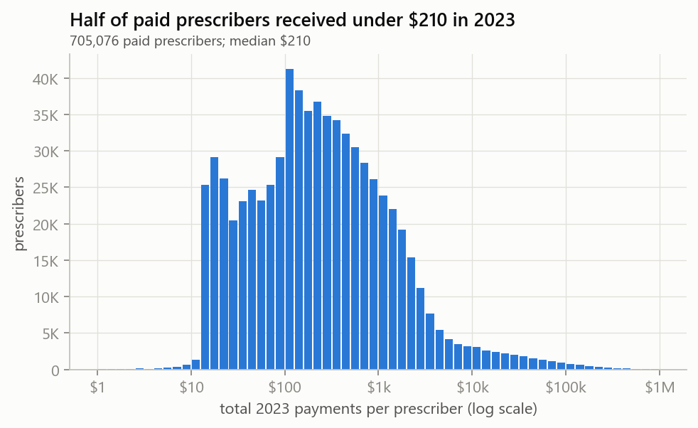
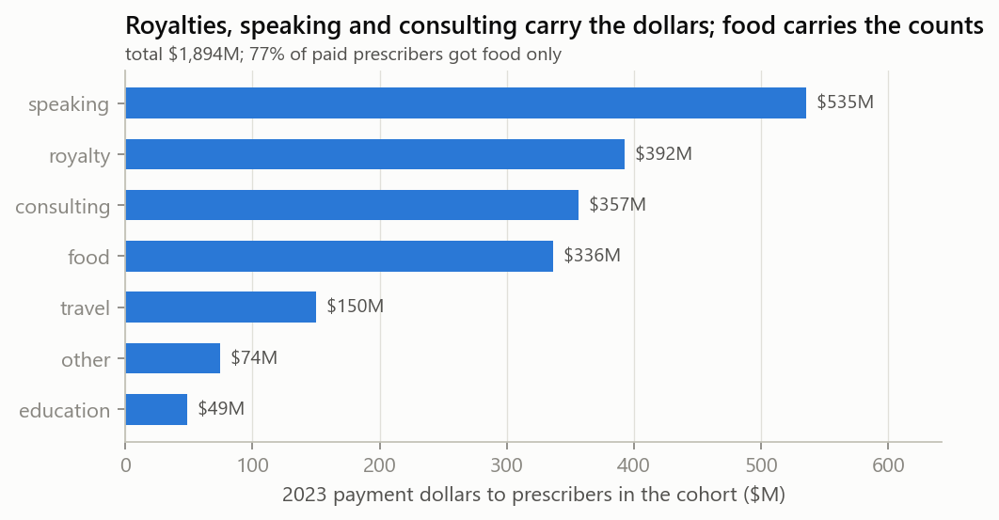

**Brand share is right-skewed.** Most prescribers sit under 20%. The spike at exactly 50% is an artifact of tiny prescribers whose counts are almost all hidden (`y_share_uninformative`).

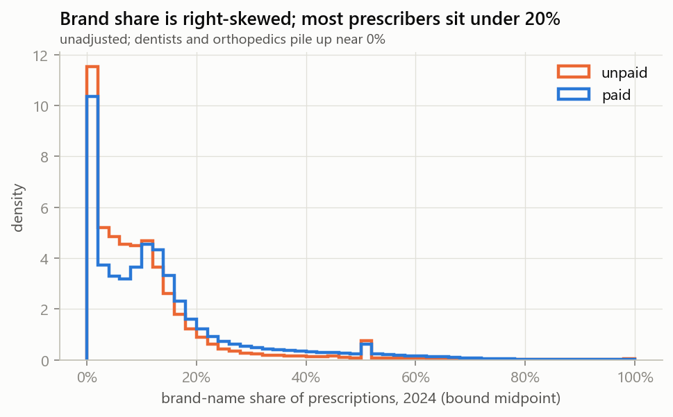

**Who gets paid varies strongly by specialty**, from 14% (trainees) to 83% (orthopedic surgery), so specialty is the key confounder. Region and rural/urban matter less: at the state level, payment rate and brand share are nearly unrelated (r = -0.05).

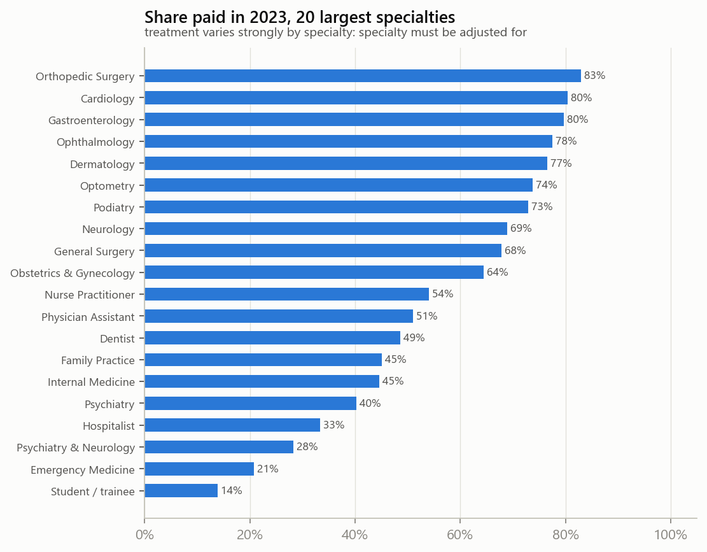

**Paid prescribers differ before payment.** They had larger practices (SMD up to 0.46) and higher 2022 brand share. Prescribing is persistent (2022 vs 2024 brand share, r = 0.81), which makes the baseline the most important covariate. Propensity weighting balances every covariate.

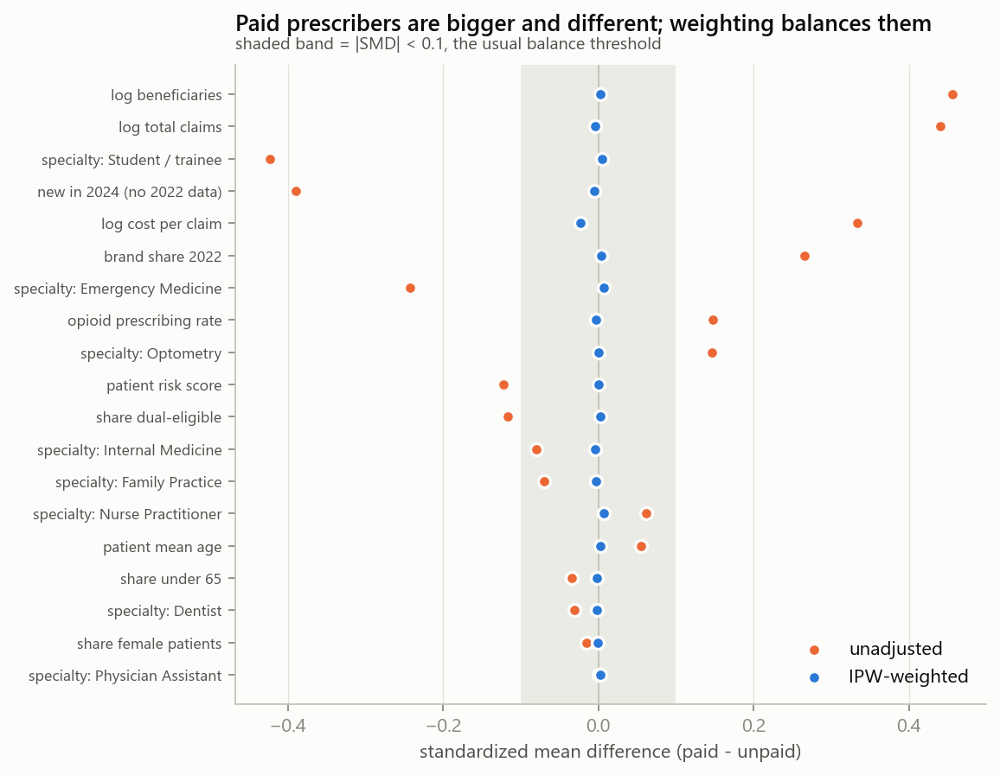

**Trends by payment history (unadjusted).** From 2022 to 2024, only the newly paid group's brand share rose; never-paid, always-paid and paid-2022-only groups declined.

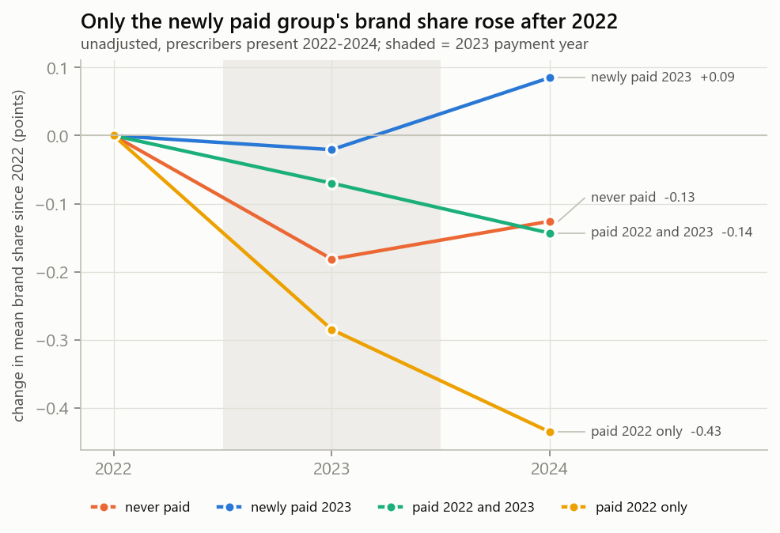

**Dose-response** (Step 6, adjusted):

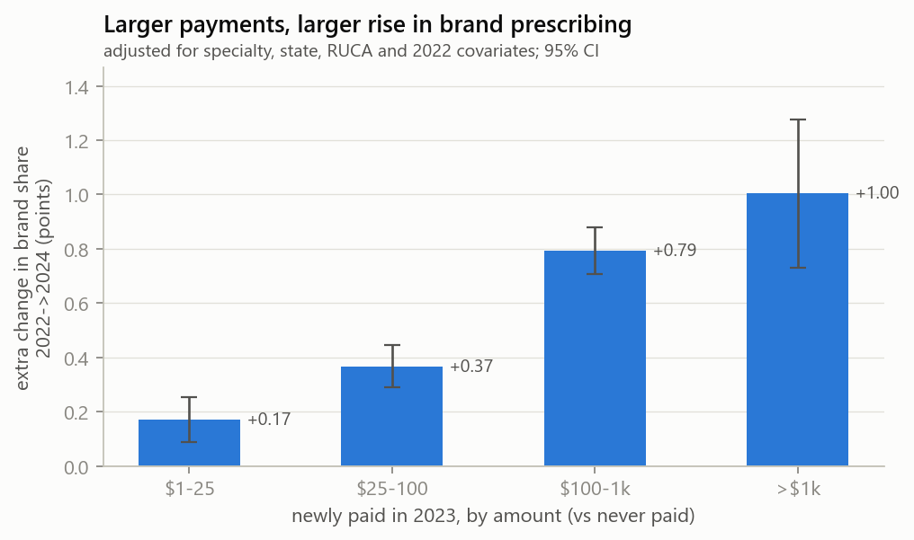

## Separability, overlap and matching

**Separability.** Specialty is the strongest single predictor of payment (AUC 0.69), followed by practice size (0.62-0.63). All features together give AUC **0.755** (logistic) and **0.782** (gradient boosting). The small gain from boosting means the logistic model captures most of the structure.

**Overlap.** 94.9% of prescribers have a propensity between 0.1 and 0.9, so nearly every paid prescriber has comparable unpaid counterparts. Overlap is weakest for students/trainees (54% inside 0.1-0.9), ophthalmology (75%) and cardiology (77%), and estimates for these groups will be reported with care.

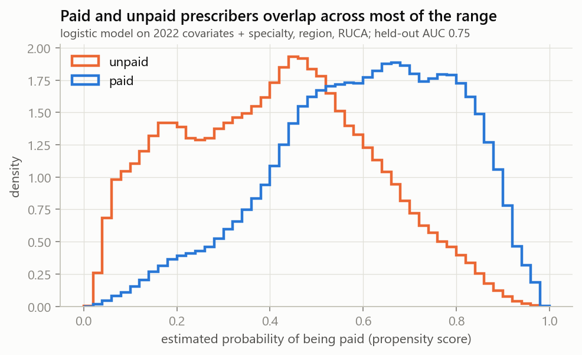

**Matching (descriptive).** Each paid prescriber was matched 1:1 to the nearest unpaid prescriber in the **same specialty** on the logit propensity score (caliper 0.2 SD, controls reusable):

- 704,889 of 705,076 paid prescribers (99.97%) were matched, using 303,093 distinct unpaid controls.
- The largest covariate imbalance fell from SMD 0.46 to 0.02.
- Pairs with uninformative bounds are excluded.

| Paid minus unpaid (points) | Low bound | Middle | High bound |
|---|---|---|---|
| Raw gap, brand share 2024 | | 3.88 | |
| Matched, brand share 2024 | 0.71 | **0.62** | 0.54 |
| Matched, change in share 2022-24 | 0.84 | **0.80** | 0.75 |

Matching removes about 85% of the raw gap. Standard errors (about 0.02 points) ignore the reuse of controls and are approximate.

**By payment type** (newly paid in 2023, unadjusted change in brand share 2022-24): never paid -0.42 points, food only -0.11, mixed -0.09, mostly speaking/consulting -0.19 (n = 2,735). Every paid group declined less than the never-paid group.

## Week 1 results summary

| Measure | Result |
|---|---|
| Payment records read (2022 + 2023) | 28.1M; $5.2B kept for physicians and practitioners |
| Final cohort | **1,383,580 prescribers**, 51.0% paid in 2023 |
| Typical payment | median $210; 77% food only |
| Paid rate by specialty | 14% to 83% |
| Persistence of prescribing | r = 0.81 (2022 vs 2024 brand share) |
| Propensity model | AUC 0.755 (logistic), 0.782 (boosting); 94.9% with propensity 0.1-0.9 |
| Paid minus unpaid brand share, 2024 | **3.9 points raw, 0.6 after matching** |
| Dose-response | +0.17, +0.37, +0.79, +1.00 points from $1-25 to >$1k |

Most of the raw gap reflects who is paid (specialty, practice size, prior prescribing). A small association that grows with the payment amount remains. **These are descriptive checks, not causal estimates.**

## Week 2: propensity models, balance and validation

**Who is compared.** Every model is fit on three cohorts. *All* is every prescriber with the Week 1 covariates; *all with history* adds 2022 payment status and dollars; *incident* keeps only prescribers with no 2022 payment, comparing the newly paid in 2023 with the never paid. About 530,000 prescribers were paid in both years, so their 2022 baseline already reflects payments; the incident cohort avoids that and is the **main analysis**.

| | All | All with history | **Incident (main)** |
|---|---|---|---|
| Prescribers | 1,383,580 | 1,383,580 | **737,618** |
| Propensity AUC, logistic / boosting | 0.755 / 0.786 | 0.861 / 0.871 | **0.666 / 0.692** |
| Propensity between 0.1 and 0.9 | 90.6% | 72.2% | **87.0%** |
| Largest IPW weight | 66 | 768 | **22** |
| Effective sample size | 60.6% | 16.7% | **86.3%** |
| Largest SMD before / after IPW | 0.46 / 0.004 | 1.53 / 0.007 | **0.36 / 0.006** |

Adding 2022 payments makes payment too predictable: one prescriber would carry a weight of 768 and only 17% of the sample would effectively count, so that cohort is dropped.

**Propensity models.** Logistic regression and gradient boosting, each with 5-fold cross-fitting (every score comes from a model that never saw that prescriber) and isotonic recalibration on 15% of each training fold. Boosting has the lowest Brier score in every cohort and is the primary model. Calibration error is about 0.002, so recalibration changes almost nothing. Extreme scores are trimmed with the Crump et al. rule [15].

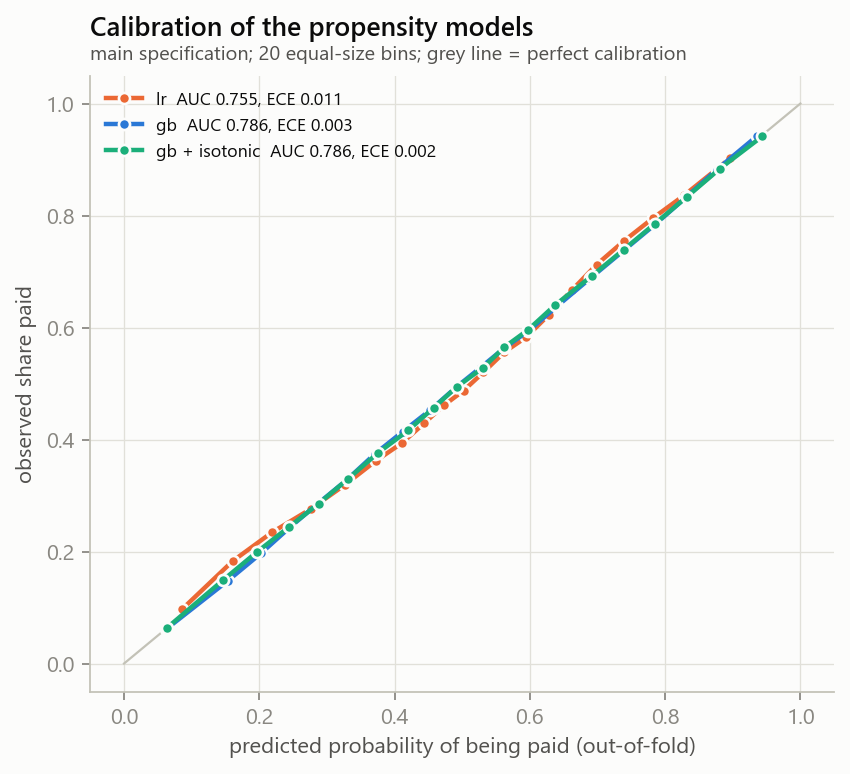
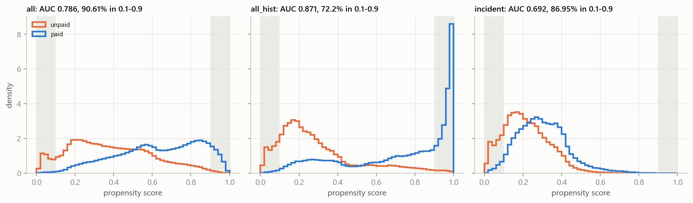

**Balance.** Every covariate, including one indicator per specialty group (99 in all), has an absolute SMD below 0.1 after weighting, in all three cohorts and under IPW, ATT and overlap weights [16]. Before weighting, 24 covariates failed.

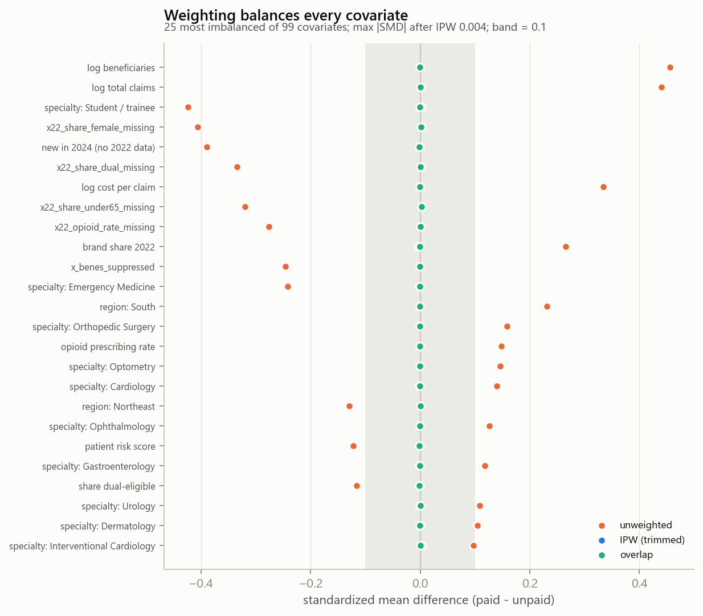

**Overlap by specialty.** Thinnest for students and trainees (54% with propensity 0.1 to 0.9), ophthalmology (71%), cardiology (75%) and gastroenterology (77%); effects for these groups are reported with care.

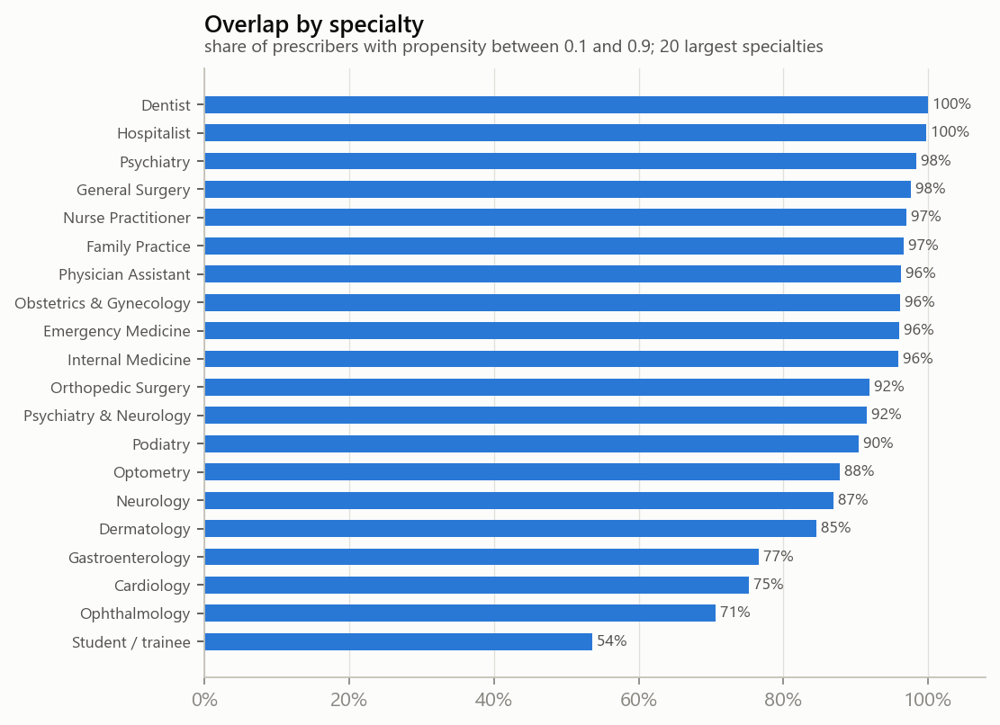

**Layer A explainability (diagnostic only).** SHAP on a boosting propensity model ranks specialty first (0.52 mean absolute log-odds), then cost per claim, region and being new in 2024. Categories must be one-hot encoded for SHAP: with native categorical splits the explainer mis-attributes them and specialty looks unimportant.

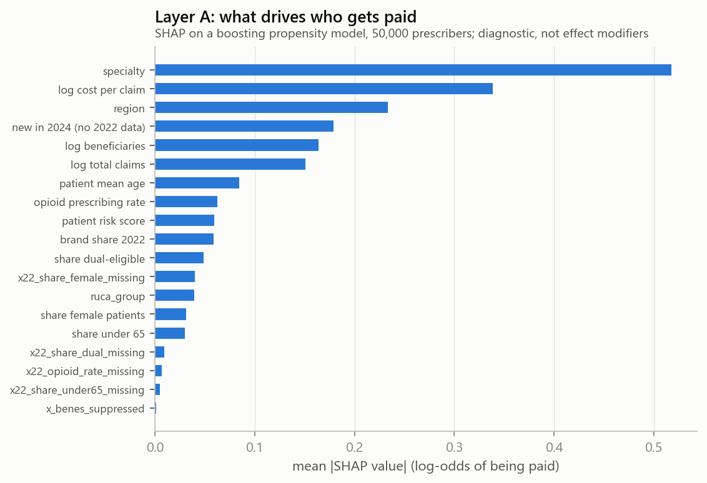

**IHDP benchmark.** 747 children, 10 replications, true effects known; 90/10 split; lower is better.

| Estimator | ATE error | sqrt PEHE, out-of-sample |
|---|---|---|
| Naive difference | 0.28 | 3.90 |
| IPW | **0.15** | 3.92 |
| DR-learner | 0.26 | **1.91** |
| Causal forest | 0.54 | 2.62 |

The DR-learner recovers individual effects best. Its first run failed (about three times the error) because a boosting propensity model returned scores near 0 and 1 with only about 140 treated children. A logistic propensity with clipping at 0.05 fixed it, and the same setting is used on the CMS data.

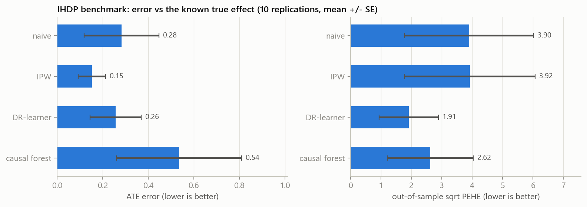

## Week 2: causal estimates

**Method.** Augmented inverse probability weighting (AIPW) [17, 18] on the incident cohort, using prescribers with informative outcome bounds. Outcome models for each arm are cross-fitted on the propensity folds, and the propensity is clipped to 0.05-0.95. The ATE is the mean of the doubly robust pseudo-outcome on the Crump-trimmed sample (610,137 prescribers). The DR-learner CATE [7] regresses that pseudo-outcome on the features with cross-fitted boosting. A causal forest [6] on a 200,000-prescriber subsample is the cross-check.

| Estimate | Effect on 2024 brand share (points) | 95% CI |
|---|---|---|
| Raw difference, newly paid vs never paid | +1.23 | |
| **ATE, AIPW (main)** | **+0.35** | 0.30 to 0.39 |
| ATE at the low / high outcome bounds | +0.42 / +0.27 | positive at both |
| ATT, AIPW | +0.29 | 0.24 to 0.33 |
| Causal forest | +0.34 | wide (subsample) |
| ATE, prescribers with a 2022 baseline | +0.49 | 0.44 to 0.55 |
| ATE, prescribers new in 2024 (no baseline) | -0.26 | reported separately |
| Secondary: all prescribers, ATE / ATT | +0.59 / +0.72 | raw 3.88 |

Adjustment removes about 72% of the raw difference, and the two estimators agree. Prescribers new in 2024 have no baseline, so their adjustment rests on filled-in values; they are reported separately.

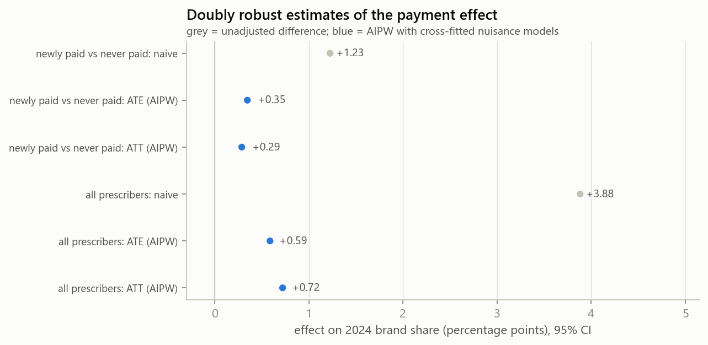

**The heterogeneity is real.** Grouping prescribers into fifths of predicted CATE, observed effects rise from -0.24 in the bottom fifth to +1.09 in the top (difference 1.33, z = 13.4), with the middle fifths in order.

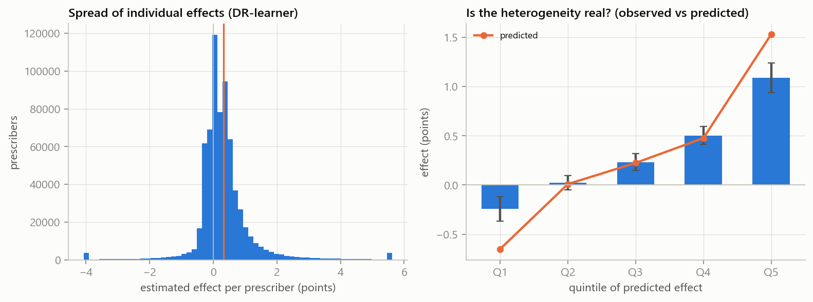

**Who responds most (Layer B).**

- **Smaller practices respond more:** +0.44 in the lowest volume third vs +0.16 in the highest.
- **Mid-range brand prescribers respond most:** 2022 brand share middle third +0.66, lowest +0.42, highest +0.41.
- **By specialty:** largest group effects in ophthalmology (+1.49), internal medicine (+0.73) and psychiatry (+0.68); about zero for dentists (+0.04) and emergency medicine (-0.03).
- **Best linear projection** [10]: internal medicine raises the effect by 0.44 points relative to nurse practitioners; larger practice (-0.17 per SD of claims) and higher 2022 brand share (-0.14 per SD) lower it; dentists, emergency medicine and trainees are significantly lower. Patient mix and location matter little.

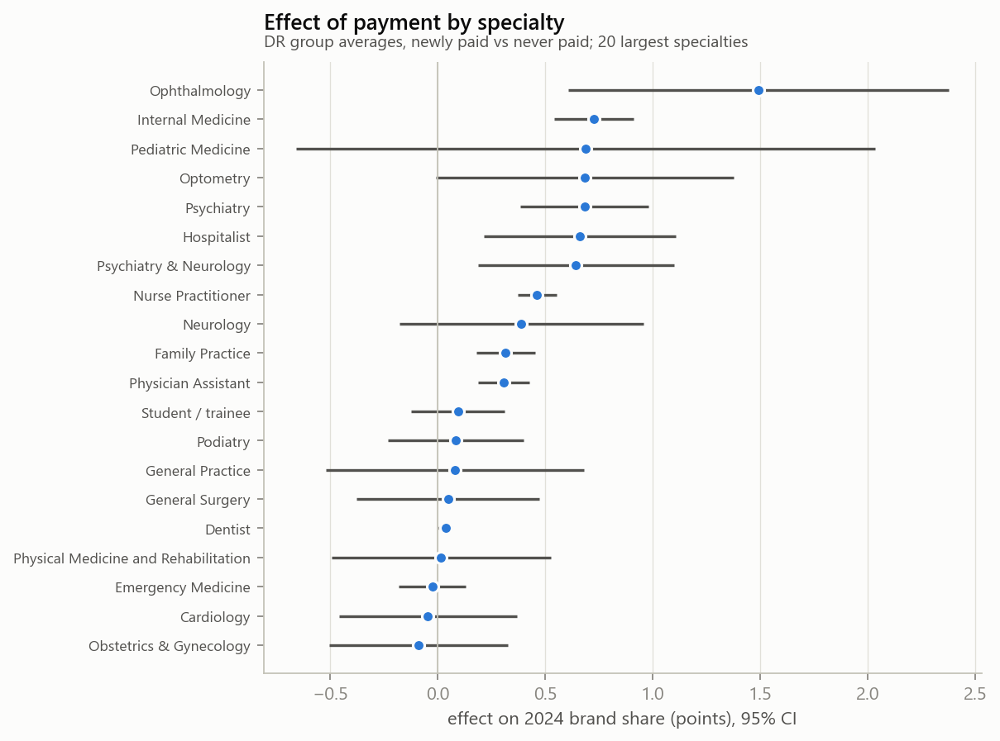
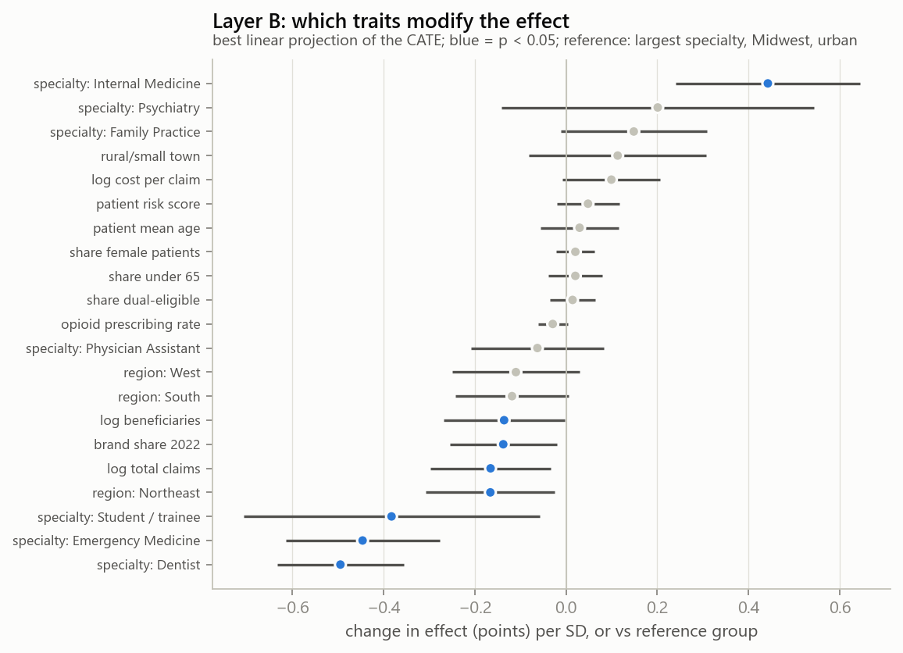

## Limitations

- **Unmeasured confounding.** Manufacturers may target prescribers already about to adopt new brand-name drugs. A sensitivity analysis is planned [14].
- **Suppression.** Outcome results must be reported at the low, middle and high bounds. Brand cost is a secondary outcome only.
- **No baseline for new prescribers.** 16% of prescribers are new in 2024; their estimated effect is negative but unreliable, and they are reported separately.
- **Thin overlap** for trainees, cardiology, ophthalmology and gastroenterology.
- **Causal forest on a subsample.** Its interval is wide; a full-cohort run is planned.
- **Modifiers are descriptive.** Effect modifiers show where the effect is larger, not why.
- **Experience.** Years in practice is not in these files; it would need the NPPES registry.
- **Second cohort.** Payments 2022 -> prescribing 2023 has no pre-payment year in the current data.

## Next steps

Week 2's four steps (calibrated propensity models, weighted sample and love plot, overlap diagnostics, IHDP benchmark) are done, along with a first run of the causal models. Next:

1. **Sensitivity analysis** [14]: how strong would an unmeasured confounder have to be to erase the effect.
2. **Layer B explainability:** SHAP on the CATE model and a short policy tree of who responds.
3. **More benchmarks:** ACIC and Twins [12, 13].
4. **Payment amount and type as treatments.**
5. **Causal forest on the full cohort**, and a subgroup-order comparison with the DR-learner.

## Data handling and privacy

- Raw CMS files are public, but this repository commits **no row-level data**. Only code, aggregate JSON logs, aggregate tables and aggregate charts are committed. Data folders and file types (`*.parquet`, `*.csv`, `*.zip`, `*.xlsx`, `*.pdf`) are git-ignored.
- Results are reported at the population and subgroup level only; we make no claims about individual prescribers.
- If you add notebooks, show summaries rather than rows (`df.head()` would save NPIs into the notebook), or clear outputs before committing.

## References
[1] DeJong C, Aguilar T, Tseng CW, Lin GA, Boscardin WJ, Dudley RA. Pharmaceutical industry sponsored meals and physician prescribing patterns for Medicare beneficiaries. JAMA Internal Medicine, 176(8), 1114–1122, 2016.
[2] Yeh JS, Franklin JM, Avorn J, Landon J, Kesselheim AS. Association of industry payments to physicians with the prescribing of brand name statins in Massachusetts. JAMA Internal Medicine, 176(6), 763–768, 2016.
[3] Centers for Medicare & Medicaid Services. Open Payments Data, General Payment Data, Program Years 2022 and 2023. https://openpaymentsdata.cms.gov
[4] Centers for Medicare & Medicaid Services. Medicare Part D Prescribers by Provider, 2022, 2023 and 2024. https://data.cms.gov
[5] Battocchi K, Dillon E, Hei M, Lewis G, Oka P, Oprescu M, Syrgkanis V. EconML: A Python package for ML based heterogeneous treatment effects estimation. PyWhy, 2019.
[6] Wager S, Athey S. Estimation and inference of heterogeneous treatment effects using random forests. Journal of the American Statistical Association, 113(523), 1228–1242, 2018.
[7] Kennedy EH. Towards optimal doubly robust estimation of heterogeneous causal effects. Electronic Journal of Statistics, 17(2), 3008–3049, 2023.
[8] Künzel SR, Sekhon JS, Bickel PJ, Yu B. Metalearners for estimating heterogeneous treatment effects using machine learning. PNAS, 116(10), 4156–4165, 2019.
[9] van der Laan MJ, Rubin D. Targeted maximum likelihood learning. International Journal of Biostatistics, 2(1), 2006.
[10] Semenova V, Chernozhukov V. Debiased machine learning of conditional average treatment effects and other causal functions. The Econometrics Journal, 24(2), 264–289, 2021.
[11] Hill JL. Bayesian nonparametric modeling for causal inference. Journal of Computational and Graphical Statistics, 20(1), 217–240, 2011.
[12] Dorie V, Hill J, Shalit U, Scott M, Cervone D. Automated versus do it yourself methods for causal inference: Lessons learned from a data analysis competition. Statistical Science, 34(1), 43–68, 2019.
[13] Louizos C, Shalit U, Mooij JM, Sontag D, Zemel R, Welling M. Causal effect inference with deep latent variable models. NeurIPS, 2017.
[14] Cinelli C, Hazlett C. Making sense of sensitivity: Extending omitted variable bias. Journal of the Royal Statistical Society, Series B, 82(1), 39–67, 2020.
[15] Crump RK, Hotz VJ, Imbens GW, Mitnik OA. Dealing with limited overlap in estimation of average treatment effects. Biometrika, 96(1), 187–199, 2009.
[16] Li F, Morgan KL, Zaslavsky AM. Balancing covariates via propensity score weighting. Journal of the American Statistical Association, 113(521), 390–400, 2018.
[17] Robins JM, Rotnitzky A, Zhao LP. Estimation of regression coefficients when some regressors are not always observed. Journal of the American Statistical Association, 89(427), 846–866, 1994.
[18] Chernozhukov V, Chetverikov D, Demirer M, Duflo E, Hansen C, Newey W, Robins J. Double/debiased machine learning for treatment and structural parameters. The Econometrics Journal, 21(1), C1–C68, 2018.
