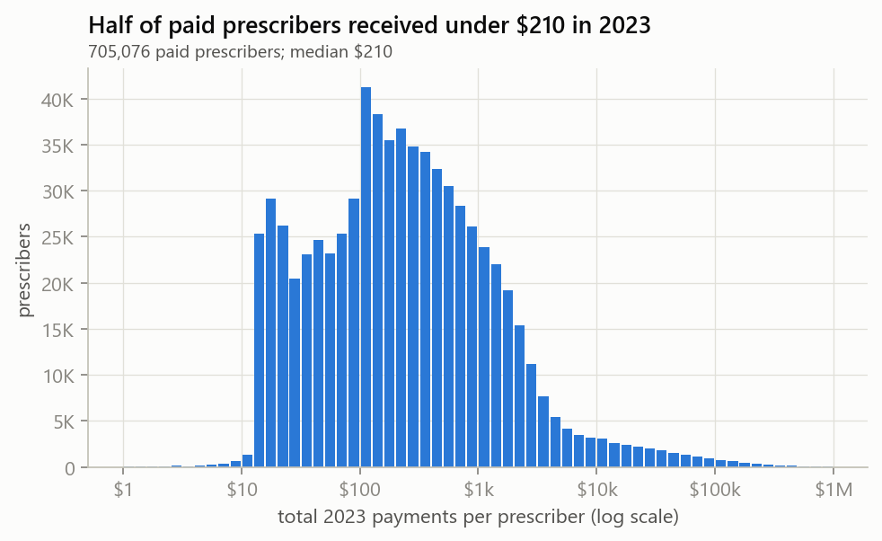
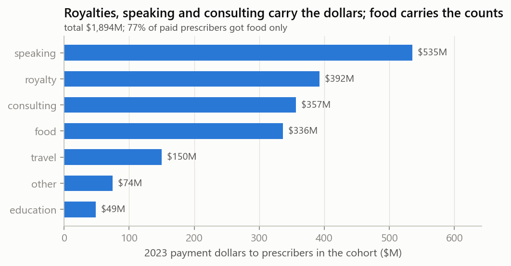
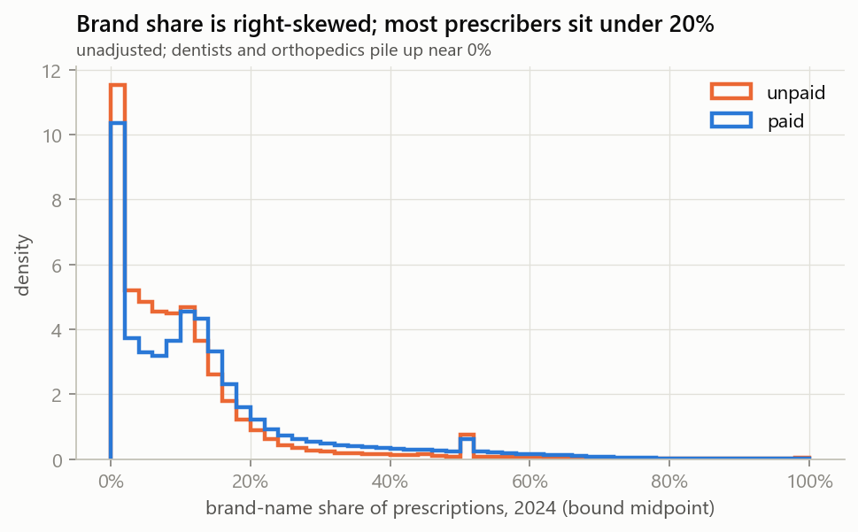
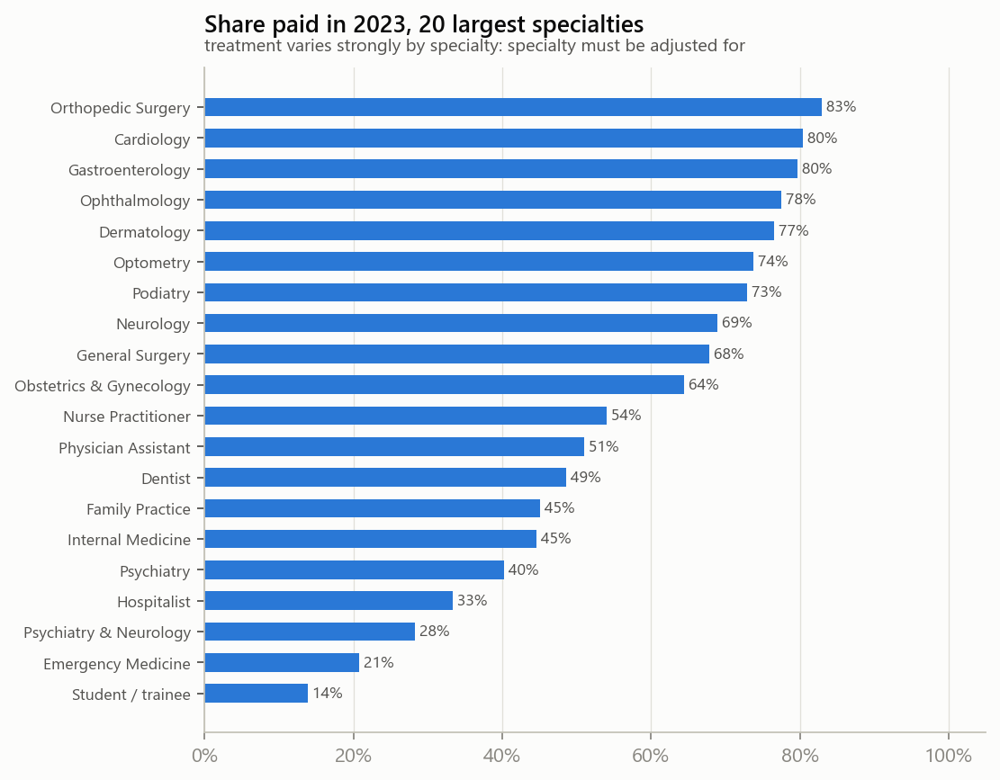
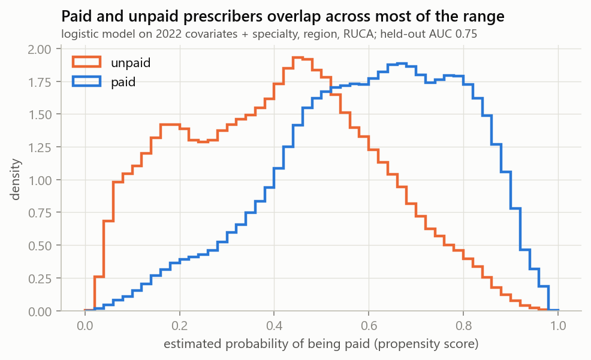
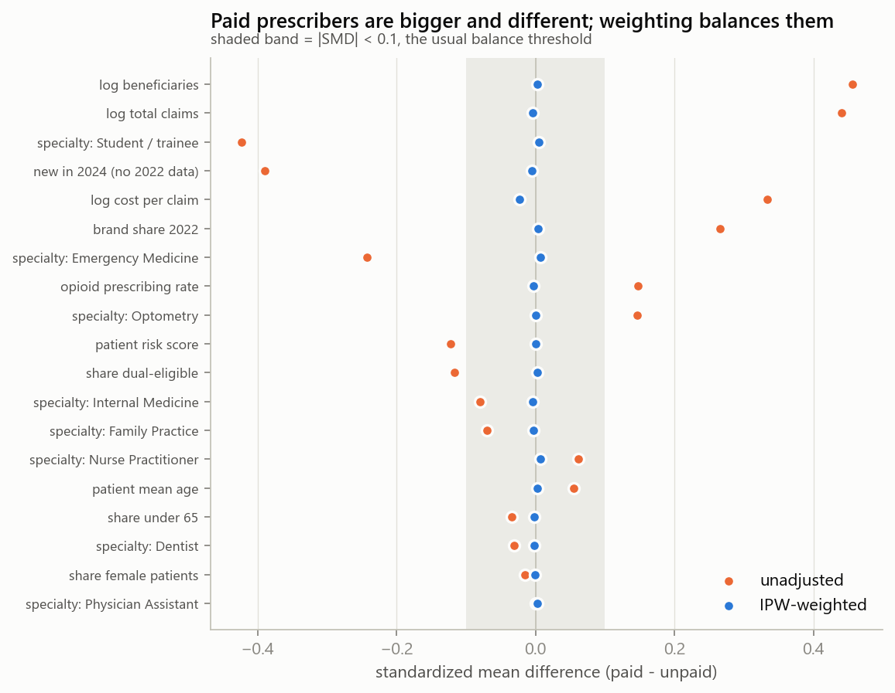
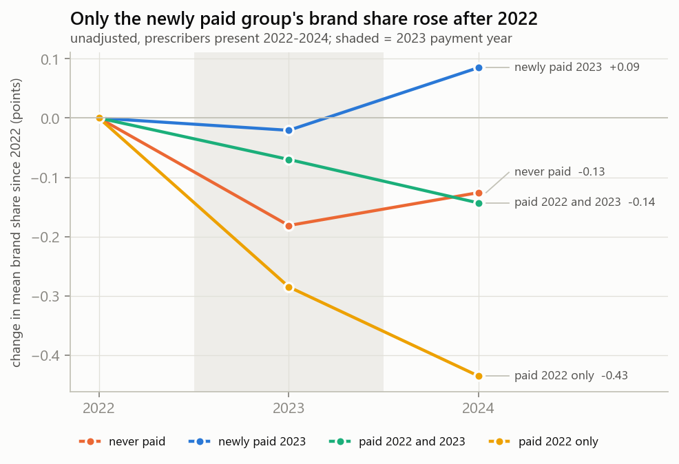
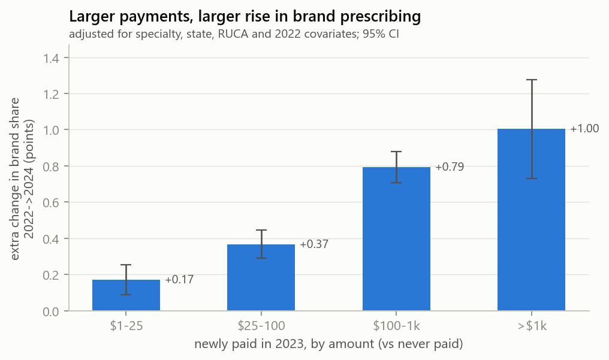

# EDA: industry payments 2023 -> Part D brand prescribing 2024

Aggregates only; generated by `scripts/08_eda.py` from `data/processed/model_2023_2024.parquet`.

## 1. Sample

| step                                             |           n |   pct_treated |   removed |   removed_treated |
|:-------------------------------------------------|------------:|--------------:|----------:|------------------:|
| Part D 2024 prescribers                          | 1.41688e+06 |          49.8 |       nan |               nan |
| organizations (entity code O)                    | 1.41688e+06 |          49.8 |         2 |                 0 |
| missing specialty                                | 1.41688e+06 |          49.8 |         1 |                 0 |
| specialties with <1% paid (no treatment overlap) | 1.38358e+06 |          51   |     33300 |                12 |

Final: **1,383,580 prescribers**, 51.0% paid in 2023, 73 specialty groups, 16.0% new in 2024, 27.0% low-volume (<50 claims), 9.6% dentists.

## 2. Missingness

|                      |   % missing | why                     |
|:---------------------|------------:|:------------------------|
| x22_share_under65    |        52.2 | suppressed (<11) by CMS |
| x22_share_dual       |        46.4 | suppressed (<11) by CMS |
| Brnd_Tot_Drug_Cst    |        44.8 | brand cost suppressed   |
| x22_opioid_rate      |        38.4 | suppressed (<11) by CMS |
| x22_share_female     |        35.4 | suppressed (<11) by CMS |
| x_brand_share_22     |        16   | not in Part D 2022      |
| x_brand_share_22_lo  |        16   | not in Part D 2022      |
| x_brand_share_22_hi  |        16   | not in Part D 2022      |
| x_brand_imputed_22   |        16   | not in Part D 2022      |
| y_change_brand_share |        16   | not in Part D 2022      |
| x_risk_score         |         0   |                         |

Brand claim counts are never missing (bounded, `brnd_imputed`); 44.8% of 2024 outcomes use the bound midpoint (37.4% paid vs 52.5% unpaid).

## 3. Treatment: payments in 2023

|     |   p10 |   p25 |   p50 |   p75 |   p90 |   p99 |
|:----|------:|------:|------:|------:|------:|------:|
| USD |    22 |    64 |   210 |   714 |  2041 | 44589 |

| pay_group   |   prescribers |   share |   pct_food_only |
|:------------|--------------:|--------:|----------------:|
| $0          |        678504 |    49   |             0   |
| $1-25       |         83491 |     6   |            95.3 |
| $25-100     |        146620 |    10.6 |            93.2 |
| $100-1k     |        337744 |    24.4 |            83.9 |
| >$1k        |        137221 |     9.9 |            32.1 |

|            |   USD millions |
|:-----------|---------------:|
| speaking   |          535.2 |
| royalty    |          392.5 |
| consulting |          356.7 |
| food       |          336.4 |
| travel     |          150.3 |
| other      |           74.4 |
| education  |           48.7 |

## 4. Outcome: brand share of claims, 2024

| treated   |      n |   mean_share |   median_share |   pooled_share |   mean_change_22_24 |
|:----------|-------:|-------------:|---------------:|---------------:|--------------------:|
| unpaid    | 678504 |       0.1019 |         0.075  |         0.1254 |              -0.002 |
| paid      | 705076 |       0.1355 |         0.1034 |         0.1561 |              -0.001 |

**Bound width.** For 6.3% of prescribers the 2024 brand-share bounds are wider than 10 points (paid 4.2%, unpaid 8.4%); almost all are tiny prescribers (11-50 claims) where CMS suppressed nearly every cell, so the midpoint is a guess (this is the spike at exactly 50% above). Flag: `y_share_uninformative`.

| 2024 total claims   |   prescribers |   median_bound_width_pts |   pct_uninformative |
|:--------------------|--------------:|-------------------------:|--------------------:|
| (10.0, 20.0]        |        106599 |                      0   |                25.4 |
| (20.0, 50.0]        |        186229 |                      0   |                21.4 |
| (50.0, 100.0]       |        172157 |                      1.3 |                11.7 |
| (100.0, 500.0]      |        427058 |                      0   |                 0   |
| (500.0, inf]        |        491537 |                      0   |                 0   |

Unadjusted, paid prescribers have a higher brand share (mean 13.5% vs 10.2%; claims-weighted 15.6% vs 12.5%), but they already differed before payment (2022 brand share, size, specialty; section 6), so this gap is confounded, not causal.

## 5. Who gets paid

| specialty               |      n |   pct_paid |
|:------------------------|-------:|-----------:|
| Nurse Practitioner      | 278188 |       54   |
| Physician Assistant     | 137097 |       51   |
| Dentist                 | 132465 |       48.6 |
| Internal Medicine       | 124014 |       44.6 |
| Family Practice         | 112587 |       45.1 |
| Student / trainee       | 101131 |       13.9 |
| Emergency Medicine      |  53343 |       20.8 |
| Optometry               |  34184 |       73.7 |
| Obstetrics & Gynecology |  32876 |       64.4 |
| Psychiatry              |  23207 |       40.3 |
| General Surgery         |  21758 |       67.8 |
| Orthopedic Surgery      |  20586 |       82.9 |
| Cardiology              |  19029 |       80.4 |
| Ophthalmology           |  18893 |       77.6 |
| Hospitalist             |  18325 |       33.3 |
| Podiatry                |  15567 |       72.8 |
| Psychiatry & Neurology  |  15201 |       28.3 |
| Gastroenterology        |  14151 |       79.7 |
| Neurology               |  14137 |       68.9 |
| Dermatology             |  13985 |       76.5 |

| region             |      n |   pct_paid |
|:-------------------|-------:|-----------:|
| Midwest            | 300579 |       48.7 |
| Northeast          | 296534 |       44.8 |
| South              | 490157 |       58.7 |
| West               | 284804 |       46.7 |
| territory_or_other |  11506 |       46.2 |

| ruca_group   |               n |   pct_paid |
|:-------------|----------------:|-----------:|
| metro        |     1.23945e+06 |       51   |
| micropolitan | 91097           |       53.4 |
| rural        | 14281           |       43.1 |
| small_town   | 36632           |       48.7 |
| unknown      |  2122           |       34.2 |

## 6. Confounding, balance and overlap

|                 |   paid |   unpaid |
|:----------------|-------:|---------:|
| share ps < 0.05 |  0.001 |    0.011 |
| share ps > 0.95 |  0.007 |    0     |
| median ps       |  0.623 |    0.416 |

| covariate                      |   unadjusted |   IPW-weighted |
|:-------------------------------|-------------:|---------------:|
| specialty: Physician Assistant |        0.001 |          0.003 |
| share female patients          |       -0.015 |         -0.001 |
| specialty: Dentist             |       -0.031 |         -0.002 |
| share under 65                 |       -0.034 |         -0.002 |
| patient mean age               |        0.055 |          0.002 |
| specialty: Nurse Practitioner  |        0.061 |          0.007 |
| specialty: Family Practice     |       -0.07  |         -0.003 |
| specialty: Internal Medicine   |       -0.079 |         -0.004 |
| share dual-eligible            |       -0.116 |          0.003 |
| patient risk score             |       -0.122 |          0     |
| specialty: Optometry           |        0.146 |          0     |
| opioid prescribing rate        |        0.148 |         -0.003 |
| specialty: Emergency Medicine  |       -0.242 |          0.008 |
| brand share 2022               |        0.266 |          0.004 |
| log cost per claim             |        0.334 |         -0.023 |
| new in 2024 (no 2022 data)     |       -0.39  |         -0.006 |
| specialty: Student / trainee   |       -0.423 |          0.005 |
| log total claims               |        0.44  |         -0.004 |
| log beneficiaries              |        0.456 |          0.003 |

Propensity model held-out AUC = 0.755. Max |SMD| unadjusted 0.46, after IPW 0.02. Share of all prescribers with ps<0.05: 0.6%, ps>0.95: 0.4%.

## 7. Brand share over time by payment history

| history            |      n |   y2022 |   y2023 |   y2024 |   change_22_24_pts |
|:-------------------|-------:|--------:|--------:|--------:|-------------------:|
| never paid         | 404768 |   10.26 |   10.08 |   10.14 |              -0.13 |
| newly paid 2023    | 133214 |   10.79 |   10.77 |   10.88 |               0.09 |
| paid 2022 and 2023 | 500403 |   14.57 |   14.5  |   14.43 |              -0.14 |
| paid 2022 only     | 104575 |   10.66 |   10.37 |   10.22 |              -0.43 |

## 8. Dose-response (adjusted screen from `06_low_payment_check.py`)

| group   |    lo |   mid |    hi |
|:--------|------:|------:|------:|
| $1-25   | 0.339 | 0.171 | 0.033 |
| $25-100 | 0.559 | 0.367 | 0.218 |
| $100-1k | 1.037 | 0.794 | 0.613 |
| >$1k    | 1.32  | 1.004 | 0.754 |

## Takeaways for modeling

- Treatment is common (51%) and mostly small: median $210; 77% of paid prescribers got food only. Model dose (`pay_log1p_usd`, `pay_group`) alongside the binary treatment.
- Strong confounding: paid prescribers are larger (SMD ~0.45 on claims/beneficiaries), had higher 2022 brand share, and differ by specialty. Weighting on 2022 covariates balances them (all |SMD| < 0.1).
- Royalties/licenses are the largest dollar category but reward device inventors, not prescribing; consider excluding `usd_royalty` from dose measures.
- Overlap is adequate (AUC 0.75); trim or clip extreme propensities before IPW/DR estimation.
- Use the 2022 baseline: prescribers new in 2024 (16%) lack it; analyze them separately or impute with a flag.
- Suppression: patient-mix covariates are 35-52% missing; keep missing-indicators. Report outcome results at low/mid/high bounds.
- Restrict the share outcome to prescribers with informative bounds (`~y_share_uninformative`), or use brand claim counts; the midpoint share is unreliable for tiny prescribers (spike at 50%).
- Dentists (~10%) and low-volume prescribers (~27%) have near-zero, noisy brand shares; run sensitivity analyses excluding them.
